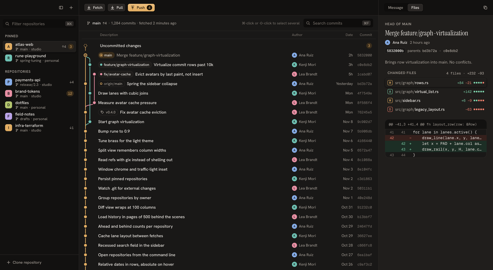

# git-ex-machina

A native git client: a GPU-rendered app built with [Rune](https://github.com/anomalyco/rune) and a CLI, `gxm`, in Rust. It shows a repository's history as a graph and makes branches, worktrees, pulls, pushes and diffs easy, across GitHub, GitLab and Bitbucket. SSH is the default; HTTPS is opt-in.



## Run it

Install [rustup](https://rustup.rs) (the project pins its toolchain), then:

```sh
cargo run -p gxm-app          # the app, on your workspace
cargo run -p gxm-cli -- repos # the CLI
cargo xtask help              # checks, worlds, snapshots, journeys
```

## How it's verified

Every workflow is a **journey**: a long, user-shaped script that runs against the real app, headless, in a hermetic **world** of fixture repositories. That same journey renders to the screenshots and video attached to every pull request. `cargo xtask verify` runs everything CI does. Contributors (people and agents) start at [CLAUDE.md](CLAUDE.md).

## License

Licensed under either of [Apache License, Version 2.0](LICENSE-APACHE) or [MIT license](LICENSE-MIT), at your option. Bundled fonts (Hanken Grotesk, Geist Mono) are under the SIL Open Font License; their licenses sit beside them in `crates/gxm-app/assets/fonts/`.

Unless you explicitly state otherwise, any contribution you intentionally submit for inclusion in this project, as defined in the Apache-2.0 license, shall be dual licensed as above, without any additional terms or conditions.

